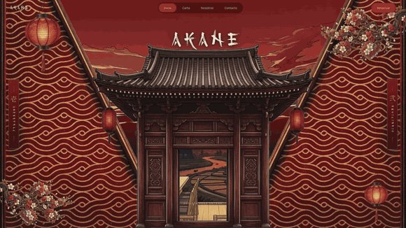
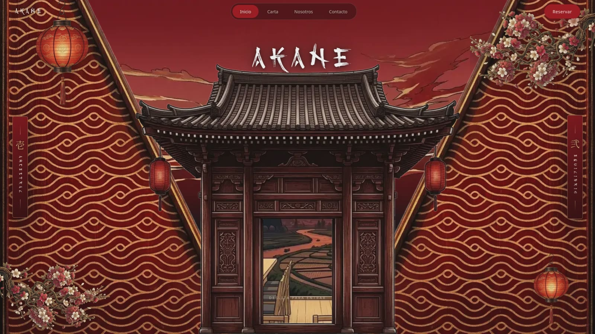
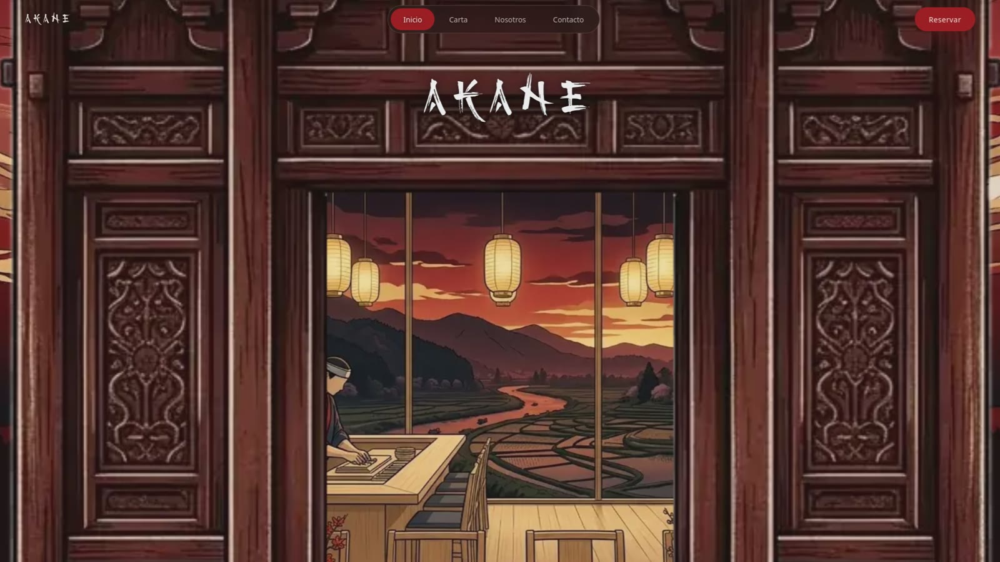
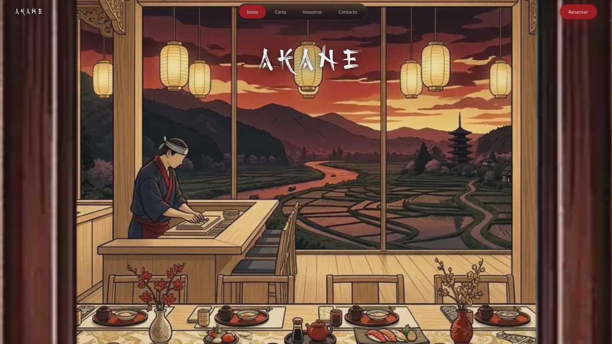
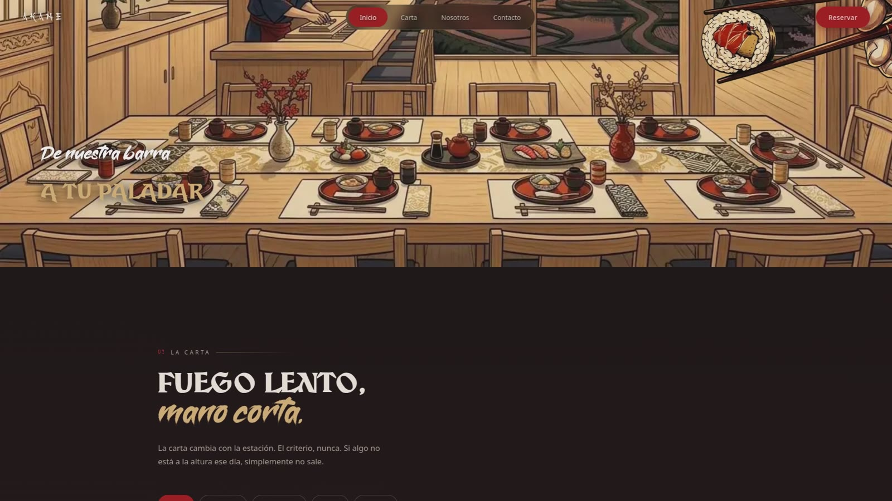

  

  
  
  
  

> **Prototipo de animaciones cinematográficas.** AKANE es un restaurante japonés **ficticio**, creado para experimentar con una entrada 3D guiada por el scroll. No es un negocio real.

## Qué es

Una web de una sola página en la que **la cámara atraviesa el pórtico de un templo** mientras haces scroll y te lleva al interior del restaurante. La escena se construye por **capas** (cielo, templo, interior y primeros planos) que se mueven a distinta velocidad para crear profundidad.

茜 *(akane)* es el rojo profundo de la raíz de rubia: el color del cielo justo antes de la noche. De ahí sale toda la paleta.

## Lo más interesante

| | |
|---|---|
| 🎬 **Entrada 3D por scroll** | Zoom cinematográfico a través del pórtico, sincronizado con el desplazamiento |
| 🪶 **Sin librerías** | Ni GSAP, ni Three.js, ni Lenis: HTML, CSS y JavaScript puros |
| 🧱 **Escena por capas** | Imágenes WebP optimizadas que se combinan con parallax |
| 🔤 **Tipografías subseteadas** | Solo los caracteres necesarios, para que cargue rápido |
| ♿ **Accesible y con SEO** | Metadatos, datos estructurados (JSON-LD) e intro que se puede saltar |
| 📱 **Responsive** | Se adapta a móvil y escritorio |

## Capturas

  
  
  
  

---

© 2026 Daniel Dans · El código fuente es privado · Todos los derechos reservados

